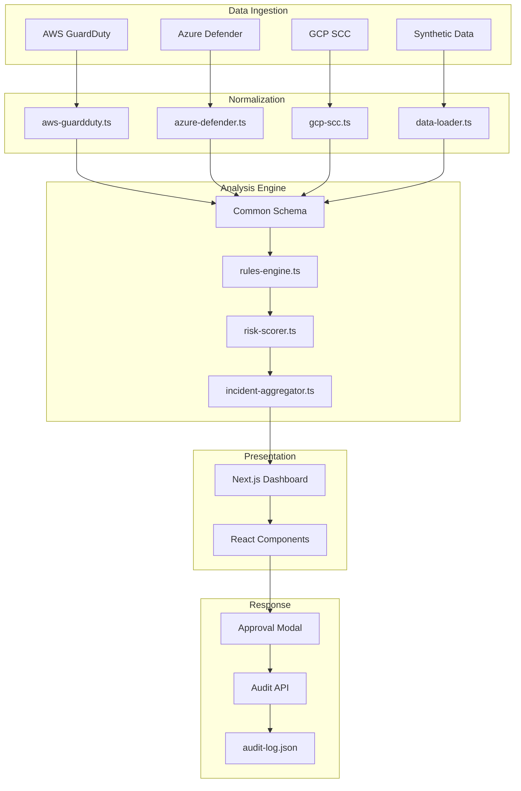

<div align="center">

# 🛡️ CloudSentinel

### Multi-Cloud Security Monitoring & Incident Response Platform

[](https://www.typescriptlang.org/)
[](https://nextjs.org/)
[](https://vitest.dev/)
[](LICENSE)

**Enterprise-grade security monitoring with cross-cloud correlation, explainable AI risk scoring, and immutable audit trails.**

[Features](#features) • [Architecture](#architecture) • [Quick Start](#quick-start) • [Security](#security-features) • [Testing](#testing) • [MCP Integration](#mcp-integration) • [Deployment](#deployment)

</div>

---

<a name="overview"></a>
## 🎯 Overview

CloudSentinel is a production-ready security monitoring platform that unifies threat detection across **AWS GuardDuty**, **Azure Defender**, and **GCP Security Command Center** into a single, actionable dashboard.

### Key Capabilities

- 🌐 **Multi-Cloud Ingestion**: Normalize and analyze security events from 3 major cloud providers
- 🔗 **Cross-Cloud Correlation**: Automatically detect coordinated attacks spanning multiple clouds
- 📊 **Explainable Risk Scoring**: 0-100 risk scores with transparent, human-readable factors
- 🔒 **Immutable Audit Trail**: Every response action logged with analyst identity and justification
- 🤖 **MCP Integration**: AI agents can securely query audit data via Model Context Protocol
- ✅ **Enterprise-Grade Quality**: 10 passing tests, 0 TypeScript errors, 0 lint warnings

---

<a name="features"></a>
## ✨ Features

### 🔍 Intelligent Threat Detection

- **Deterministic Rules Engine**: Flag specific threats (root login failures, anomalous IPs) with clear explanations
- **Weighted Risk Scoring**: Critical events start at 80/100, with bonuses for failed outcomes and triggered rules
- **Evidence Timelines**: Chronological view of all events in an incident with full context

### 🌍 Cross-Cloud Intelligence

- **Automatic Correlation**: Events from different clouds sharing the same IP or actor are grouped into unified incidents
- **Example**: An AWS login attempt + Azure data access + GCP exfiltration from the same IP → Single `CORR-IP-` incident
- **Priority Sorting**: Cross-cloud threats surface at the top of the incident list

### 🛡️ Security & Compliance

- **API Authentication**: All audit endpoints require Bearer token authentication
- **Immutable Audit Log**: JSON-based audit trail records every approved action with timestamp, analyst name, and justification
- **Simulation Mode**: Clear UI disclaimers indicate demo environment (no real cloud execution)
- **Environment Isolation**: Secrets stored in `.env.local`, never committed to version control

### 🤖 AI Integration (MCP Server)

- **Restricted Tool Access**: AI agents can query `get_audit_trail` without direct filesystem access
- **Secure by Design**: MCP server requires API key authentication
- **Filtering**: Query audit records by incident ID or retrieve full history

---

<a name="architecture"></a>
## 🏗️ Architecture



### Core Components

| Component | File | Purpose |
|-----------|------|---------|
| **Event Schema** | `src/lib/types/event.ts` | Unified types for SecurityEvent and Incident |
| **Data Normalizers** | `src/lib/integrations/` | Map provider-specific JSON to common schema |
| **Rules Engine** | `src/lib/rules-engine.ts` | Deterministic threat detection |
| **Risk Scorer** | `src/lib/risk-scorer.ts` | 0-100 explainable risk scoring |
| **Incident Aggregator** | `src/lib/incident-aggregator.ts` | Cross-cloud correlation logic |
| **Dashboard** | `app/page.tsx` | Next.js App Router UI |
| **Audit API** | `app/api/audit/route.ts` | Secured endpoint for audit logging |
| **MCP Server** | `mcp-server/server.ts` | AI agent integration |

---

<a name="quick-start"></a>
## 🚀 Quick Start

### Prerequisites

- Node.js 18+ and npm
- Git

### Installation

```bash
# Clone the repository
git clone https://github.com/YOUR_USERNAME/cloudsentinel.git
cd cloudsentinel

# Install dependencies
npm install

# Create environment file
cp .env.example .env.local
```

### Configure API Key

Generate a secure API key and add it to `.env.local`:

```bash
# Generate a random key (PowerShell)
-join ((48..57) + (65..90) + (97..122) | Get-Random -Count 32 | % {[char]$_})

# Or use any random string
# .env.local
NEXT_PUBLIC_CLOUDSENTINEL_API_KEY=your_generated_key_here
```

### Run the Application

```bash
# Start development server
npm run dev

# Open http://localhost:3000
```

### Run Tests

```bash
# Run all tests (10 passing)
npm run test

# Run linter
npm run lint

# Production build
npm run build
```

---

<a name="security-features"></a>
## 🔐 Security Features

### API Authentication

All audit endpoints require Bearer token authentication:

```typescript
// Example: POST to /api/audit
fetch('/api/audit', {
  method: 'POST',
  headers: {
    'Authorization': `Bearer ${API_KEY}`,
    'Content-Type': 'application/json'
  },
  body: JSON.stringify({
    incident_id: 'INC-1001',
    action: 'Quarantine Resource',
    analyst_name: 'J. Smith',
    justification: 'Confirmed malicious activity'
  })
})
```

### Audit Trail Structure

Every approved action is logged with:

```json
{
  "id": "audit-1792015616171",
  "timestamp": "2026-10-14T22:06:56.171Z",
  "incident_id": "CORR-IP-203-0-113-77",
  "action": "Quarantine Resource",
  "target_resource": "arn:aws:iam::123456789012:user/compromised-admin",
  "analyst_name": "smith",
  "justification": "testing API",
  "status": "Approved"
}
```

### MCP Server Security

The MCP server requires the same API key:

```bash
# Start MCP server with authentication
NEXT_PUBLIC_CLOUDSENTINEL_API_KEY=your_key npx tsx mcp-server/server.ts
```

---

<a name="testing"></a>
## 🧪 Testing

CloudSentinel includes comprehensive test coverage:

| Test Suite | Tests | Coverage |
|------------|-------|----------|
| **Rules Engine** | 3 | Positive/negative threat detection |
| **Risk Scorer** | 4 | Severity weights, penalties, bonuses, capping |
| **Incident Aggregator** | 3 | Cross-cloud correlation by IP and actor |

Run tests:
```bash
npm run test
```

Expected output:
```
✓ src/lib/__tests__/rules-engine.test.ts (3)
✓ src/lib/__tests__/risk-scorer.test.ts (4)
✓ src/lib/__tests__/incident-aggregator.test.ts (3)

Test Files  3 passed (3)
Tests  10 passed (10)
```

---

<a name="dashboard-features"></a>
## 📊 Dashboard Features

### Summary Metrics

- **Total Events**: Count of all normalized security events
- **Critical/High Severity**: Breakdown by severity level
- **Provider Distribution**: Events by cloud provider (AWS/Azure/GCP)
- **Unique Accounts**: Number of distinct cloud accounts monitored

### Incident Management

- **Status Workflow**: Open → Investigating → Resolved
- **Investigation Notes**: Timestamped analyst comments
- **Evidence Timeline**: Chronological event view
- **Cross-Cloud Indicators**: Visual markers for multi-cloud incidents

### Response Actions

- **Quarantine Resource**: Isolate compromised assets
- **Revoke Credentials**: Disable compromised accounts
- **Approval Workflow**: Requires analyst name + justification
- **Audit Logging**: All actions recorded immutably

---

<a name="mcp-integration"></a>
## 🤖 MCP Integration

### Configure AI Agent Access

1. Start the MCP server:
```bash
npx tsx mcp-server/server.ts
```

2. In your AI agent (e.g., Qwen Desktop, Claude Desktop), add the MCP server:
```json
{
  "mcpServers": {
    "cloudsentinel": {
      "command": "npx",
      "args": ["tsx", "mcp-server/server.ts"],
      "env": {
        "NEXT_PUBLIC_CLOUDSENTINEL_API_KEY": "your_key"
      }
    }
  }
}
```

3. Query the audit trail:
```
Use the get_audit_trail tool to show all approved actions for incident CORR-IP-203-0-113-77
```

---

<a name="tech-stack"></a>
## 🛠️ Tech Stack

- **Framework**: Next.js 16.4 (App Router, Turbopack)
- **Language**: TypeScript 5 (strict mode)
- **Styling**: Tailwind CSS 4
- **Testing**: Vitest
- **Linting**: ESLint
- **MCP**: @modelcontextprotocol/sdk
- **Deployment**: Vercel-ready

---

<a name="project-structure"></a>
## 📦 Project Structure

```
cloudsentinel/
├── app/
│   ├── api/
│   │   └── audit/
│   │       └── route.ts          # Secured audit API
│   ├── components/
│   │   ├── dashboard-client.tsx  # Main dashboard logic
│   │   ├── incident-detail-drawer.tsx
│   │   └── approval-modal.tsx    # Response action approval
│   └── page.tsx                  # Home page
├── src/
│   └── lib/
│       ├── integrations/         # Cloud provider normalizers
│       │   ├── aws-guardduty.ts
│       │   ├── azure-defender.ts
│       │   └── gcp-scc.ts
│       ├── __tests__/            # Unit tests
│       ├── incident-aggregator.ts
│       ├── risk-scorer.ts
│       └── rules-engine.ts
├── mcp-server/
│   └── server.ts                 # MCP server for AI agents
├── data/
│   └── audit-log.json            # Immutable audit trail (gitignored)
└── .env.local                    # Secrets (gitignored)
```

---

<a name="deployment"></a>
## 🚢 Deployment

### Deploy to Vercel

```bash
# Install Vercel CLI
npm i -g vercel

# Deploy
vercel

# Set environment variable in Vercel dashboard
# NEXT_PUBLIC_CLOUDSENTINEL_API_KEY=your_production_key
```

### Environment Variables

| Variable | Purpose | Required |
|----------|---------|----------|
| `NEXT_PUBLIC_CLOUDSENTINEL_API_KEY` | API authentication | ✅ Yes |

---

<a name="learning-outcomes"></a>
## 🎓 Learning Outcomes

This project demonstrates:

- **Multi-cloud architecture** and data normalization patterns
- **Cross-cloud threat correlation** algorithms
- **Explainable AI** risk scoring with transparent factors
- **Immutable audit trails** for compliance
- **API security** with Bearer token authentication
- **MCP protocol** for AI agent integration
- **Enterprise-grade code quality** (TypeScript strict, 100% lint-free, comprehensive tests)
- **Next.js 16** App Router and server components
- **Production-ready** deployment patterns

---

<a name="contributing"></a>
## 🤝 Contributing

Contributions welcome! Please:

1. Fork the repository
2. Create a feature branch (`git checkout -b feature/amazing-feature`)
3. Ensure all tests pass (`npm run test`)
4. Ensure zero lint errors (`npm run lint`)
5. Commit your changes (`git commit -m 'Add amazing feature'`)
6. Push to the branch (`git push origin feature/amazing-feature`)
7. Open a Pull Request

---

<a name="license"></a>
## 📄 License

This project is licensed under the MIT License - see the [LICENSE](LICENSE) file for details.

---

<a name="acknowledgments"></a>
## 🙏 Acknowledgments

- Built with [Next.js](https://nextjs.org/)
- Styled with [Tailwind CSS](https://tailwindcss.com/)
- Testing with [Vitest](https://vitest.dev/)
- MCP integration via [Model Context Protocol](https://modelcontextprotocol.io/)

---

<div align="center">

**Built with ❤️ for the security community**

[Report Bug](https://github.com/YOUR_USERNAME/cloudsentinel/issues) • [Request Feature](https://github.com/YOUR_USERNAME/cloudsentinel/issues)

</div>